

  

  
  
  
  
  
  

 

  

 

<!-- ================= ARSENAL ================= -->

  

 

<!-- ================= CREDENTIALS ================= -->

  

 

<!-- ================= CASE FILES ================= -->

  
  
  

 

<!-- ================= FOOTER ================= -->

  

  
  &nbsp;&nbsp;
  
  &nbsp;&nbsp;
  

